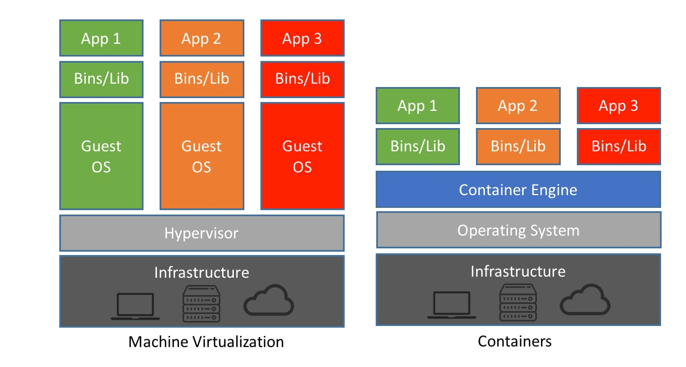
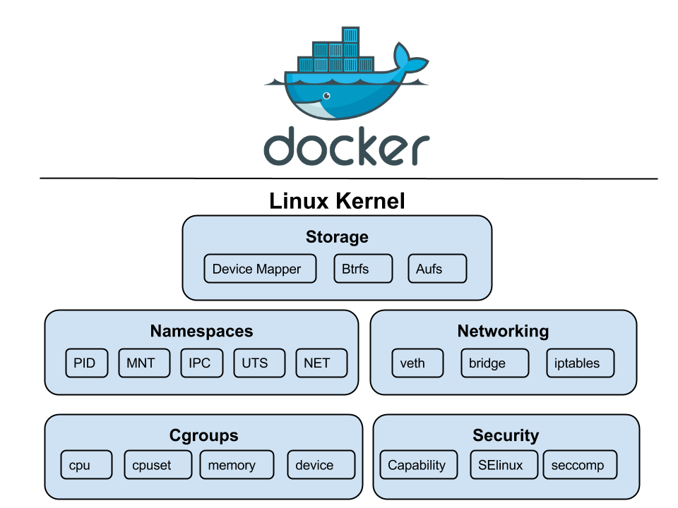
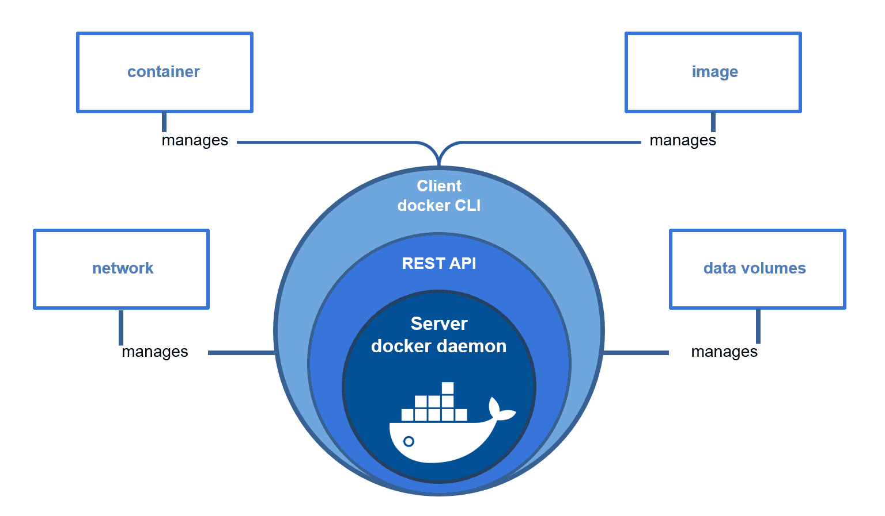

# An Introduction to Containerization

## The Problem Containers Solve

"It works on my machine." An application rarely runs on its own. It needs a specific language version, specific
libraries, system packages, configuration files, and environment variables. Every difference between a developer's
laptop, the test server, and production is a chance for something to break.

Before containers, teams fought this with long setup documents, configuration management scripts, or by giving
every application its own virtual machine. Containers take a different approach: **package the application together
with everything it needs, and run that package the same way everywhere.**

## What is Containerization?

Containerization is a lightweight and portable method of packaging an application and all its dependencies (libraries,
configuration files, and binaries) into a single, isolated unit called a **container**. The same container runs
consistently on a developer's laptop, in a corporate data center, or in the public cloud.

Two terms you'll use constantly:

- **Image**: the package. A read-only template containing the application and its dependencies. Built once, stored in a registry, and copied anywhere.
- **Container**: a running instance of an image. You can start many containers from the same image, just as you can run many copies of the same program.

## How Containers Differ from Virtual Machines (VMs)

Both provide isolated environments for running applications, but they do it at different levels.

### Virtual Machines
A VM runs a complete, independent **guest operating system** on top of a hypervisor, which emulates hardware. Each VM
includes the application, its dependencies, *and* an entire OS kernel and userland: gigabytes of disk, minutes to boot,
and memory reserved for each OS.

### Containers
Containers **share the host's OS kernel**. Instead of emulating hardware, the kernel gives each container its own
isolated view of the system. A container only needs the application and its dependencies, so it is typically megabytes
in size, starts in seconds or less, and many can run side by side on one host.

| | Virtual Machine | Container |
|---|---|---|
| Isolates | Hardware (via hypervisor) | Processes (via the host kernel) |
| Includes an OS kernel | Yes, its own | No, shares the host's |
| Typical size | Gigabytes | Megabytes |
| Startup time | Minutes | Seconds or less |
| Isolation strength | Stronger: separate kernels | Weaker: one shared kernel |
| Can run a different OS | Yes (e.g. Windows on a Linux host) | No: Linux containers need a Linux kernel |

> **Key insight:** The absence of a separate guest OS is what makes containers so efficient. The trade-off is that
> all containers on a host share one kernel, so a kernel vulnerability can affect all of them. That's why cloud
> providers often run your containers *inside* VMs, or in lightweight "micro-VMs" (e.g. AWS Firecracker), to get both.

**Why does Docker work on a Mac or Windows laptop, then?** Docker Desktop quietly runs a small Linux VM and your
containers run inside it.

## Core Linux Technologies: The Foundation of Containers

A container isn't a single kernel feature. It's an ordinary Linux process, wrapped with several kernel features that
control **what it can see** and **how much it can use**.

### 1. Namespaces: what a process can *see*

Namespaces partition kernel resources so that one set of processes sees one set of resources while another set of
processes sees a different set. This is the primary technology for creating the isolated environment of a container.

#### Key Namespace Types:

- **PID (Process ID):** Isolates process IDs, so the container's main process is PID 1 inside the container while having an ordinary PID (e.g. 15496) on the host. Processes in the container can't see processes outside it.
- **NET (Network):** Gives each container its own network stack: interfaces, IP addresses, routing tables, and ports. Two containers can both listen on port 3306 without clashing.
- **MNT (Mount):** Gives each container its own filesystem tree. The container sees its image's files at `/`, not the host's files.
- **UTS (UNIX Time-Sharing):** Isolates the hostname and domain name, so each container can have its own hostname.
- **IPC (Inter-Process Communication):** Isolates shared memory and message queues between processes.
- **User:** Maps user IDs, so a process can be `root` inside the container while being an unprivileged user on the host (this is how *rootless* containers work).
- **Cgroup:** Hides the host's cgroup hierarchy, so a container only sees its own resource-control settings.
- **Time:** (Linux 5.6+) Lets a container have its own offsets for some system clocks. Mainly used when checkpointing a container and restoring it later, so that time appears continuous to the application.

### 2. Control Groups (cgroups): what a process can *use*

Namespaces provide isolation. Control groups (cgroups) **limit and account for resource usage**, so that one container
can't consume all of the host's CPU or memory and starve everything else. Modern Linux distributions use **cgroups v2**.

#### Resources Managed by cgroups:
- **CPU:** Cap CPU time (e.g. "at most half a core") or set relative weights
- **Memory:** Hard memory limits. A container exceeding its limit is killed by the kernel (the "OOM killer")
- **Disk I/O:** Limit read/write bandwidth and operations per second
- **Process count (pids):** Limit how many processes a container can create, which protects against "fork bombs"

(Network bandwidth isn't limited by cgroups directly. That's handled by separate Linux traffic-control tools.)

### 3. chroot and pivot_root

`chroot` (change root), from 1979, was the earliest ancestor of container filesystem isolation: it changes the
apparent root directory (`/`) for a process. Modern runtimes use the stronger `pivot_root` together with the mount
namespace, so the container can't escape back into the host's filesystem.

### 4. Union Filesystems (OverlayFS)

Images are made of **layers**, and an overlay filesystem stacks them into a single view. Each container gets a thin
writable layer on top of the read-only image layers. That's why starting ten containers from one image doesn't copy the
image ten times, and why anything written inside a container disappears when the container is deleted, unless it's
stored in a **volume**.

### Putting It Together: Two Databases on One Host

Suppose you run two MySQL containers on the same server. Each one believes it is the only MySQL on the machine:

| | Container 1 | Container 2 | What makes it work |
|---|---|---|---|
| Main process | PID 1 inside (e.g. 15496 on host) | PID 1 inside (e.g. 15620 on host) | PID namespace |
| Config / data / socket paths | `/etc/mysql`, `/var/lib/mysql`, `/run/mysqld/mysqld.sock` | Exactly the same paths | Mount namespace: each has its own filesystem |
| Port inside the container | 3306 | 3306 | Network namespace: each has its own network stack |
| Port on the host | 3308 → 3306 | 3309 → 3306 | Port publishing (`-p 3308:3306`) |
| Hostname | `db-one` | `db-two` | UTS namespace |
| Memory limit | 2 GB | 1 GB | cgroups |
| Data that survives deletion | volume `mysql1-data` | volume `mysql2-data` | Volumes (stored outside the container) |

Neither MySQL needed to be configured differently. Containers make "run two copies of the same thing" trivial.

## Standards: the Open Container Initiative (OCI)

Docker popularized containers, but the formats are now **open standards** maintained by the Open Container Initiative:

- **Image spec**: what an image looks like (layers and metadata)
- **Runtime spec**: how to run a container from an unpacked image
- **Distribution spec**: how registries store and serve images

Because of this, an image built with Docker runs on Podman, containerd, Kubernetes, AWS ECS, Google Cloud Run, and so on,
and can be stored in any OCI-compatible registry (Docker Hub, GitHub Container Registry, Amazon ECR, ...).

## Docker: The Tool That Popularized Containers

Namespaces and cgroups existed in Linux for years before 2013, but they were hard to use. Docker made containers
accessible with a simple workflow: **build** an image from a `Dockerfile`, **ship** it through a registry, and **run** it anywhere.

### Common Docker Components

- **Docker Client (`docker`):** The command-line tool you interact with (`docker run`, `docker build`, ...)
- **Docker Daemon (`dockerd`):** The background service that does the work. It listens for API requests from the client and manages images, containers, networks, and volumes
- **Docker Registry:** Stores and distributes images. Docker Hub is the default public registry. Others include GitHub Container Registry (`ghcr.io`), Amazon ECR, and self-hosted registries such as Harbor
- **Docker Compose:** A tool for defining and running multi-container applications from a single YAML file
- **Docker Desktop:** The packaged app for macOS/Windows/Linux that includes all of the above plus the Linux VM. (Free for personal use, education, and small businesses; larger companies need a paid subscription.)

### The Docker Communication Flow

When you run `docker run nginx`, a chain of components is involved:

1. **docker (client) → dockerd (daemon):** The client sends the command to the daemon via a REST API
2. **dockerd → containerd:** The daemon handles images, networks, and volumes, and delegates running containers to **containerd**, a high-level container runtime
3. **containerd → runc:** containerd prepares the container and calls **runc**, a low-level OCI runtime
4. **runc → kernel:** runc asks the Linux kernel to create the namespaces and cgroups, then starts the container's process (e.g. nginx) inside them

This modular flow (`dockerd → containerd → runc`) is why the same containers can be run by other tools: Kubernetes, for example, talks to containerd directly without Docker at all.

## Container Runtimes

A container runtime is the software responsible for running containers.

#### Low-Level Runtimes
Create and run the container process using the kernel features above. **runc** is the reference OCI implementation and the most common. Alternatives include **crun** (faster, written in C) and **gVisor** / **Kata Containers** (extra isolation using a sandbox or micro-VM).

#### High-Level Runtimes
Manage the full container lifecycle (pulling images, storage, starting and stopping containers) and use a low-level runtime underneath.

- **containerd:** Used by Docker and by most Kubernetes clusters. A graduated CNCF project
- **CRI-O:** A lightweight runtime built specifically for Kubernetes (used by Red Hat OpenShift)

### Docker Alternatives

- **Podman:** A daemonless, Docker-compatible CLI (`podman run ...` works like `docker run ...`). Runs rootless by default
- **Rancher Desktop**, **OrbStack**, **Colima:** Alternatives to Docker Desktop for running containers on a Mac or Windows machine
- **BuildKit / Buildah:** Image build engines (BuildKit is what powers `docker build` today)

## What Comes Next: Orchestration

Running a few containers on one machine is easy, and Docker Compose handles it well. But in production you'll want to:

- Run containers across **many** servers, and decide which server runs what
- **Restart** containers automatically if they crash or a server dies
- **Scale** the number of copies up and down with demand
- Roll out new versions with **zero downtime**
- Let containers **find** each other wherever they're running

This is **container orchestration**, and **Kubernetes** is the industry standard for it. That's what we'll cover over the next two weeks.

---

## Summary

- A **container** is an isolated process: **namespaces** control what it can see, and **cgroups** control what it can use.
- Containers share the host kernel, which makes them much lighter than VMs, with somewhat weaker isolation.
- An **image** is the package, and a **container** is a running instance of it. Images are built from layers, and container data is lost on deletion unless it's stored in a **volume**.
- **OCI** standards mean images built with Docker run anywhere.
- Docker = client + daemon + containerd + runc + registries, which together let you build, ship, and run.

## Check Your Understanding

1. Your app runs as PID 15496 on a host. What PID does it see for itself inside its container, and which namespace causes this?
2. Two containers on one server both listen on port 80. Why doesn't this cause a conflict, and how would you reach each one from outside the server?
3. A container is killed with exit code 137 shortly after start. Which kernel feature is the likely cause, and what would you check?
4. Why can't you run a Windows container on a Linux host, when you can run a Windows *VM* on one?
5. You delete a container that held a database and recreate it. The data is gone. Why, and how do you prevent it?

## Further Learning

- [YouTube playlist: Linux utilities that form the core of containerization](https://youtube.com/playlist?list=PLdh-RwQzDsaNWBex2I09OFLCph7l_KnQE&si=dHJ8LAAEQnxQBOFV)
- [Docker documentation](https://docs.docker.com/)
- [Open Container Initiative](https://opencontainers.org/)
- [`man 7 namespaces`](https://man7.org/linux/man-pages/man7/namespaces.7.html) and [`man 7 cgroups`](https://man7.org/linux/man-pages/man7/cgroups.7.html)
