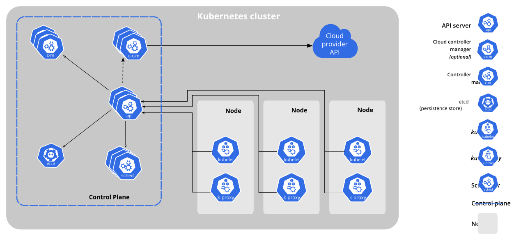

# Kubernetes Essentials

## Why Kubernetes?

Last week we ran containers with Docker and Docker Compose. That works well on **one machine**. Now imagine production:

- Your app needs 20 copies of a container, spread over 10 servers
- A server dies at 3 a.m. Who restarts its containers somewhere else?
- Traffic triples on Black Friday. Who starts more copies, and who sends traffic to them?
- You release a new version. How do you replace 20 running containers without downtime, and undo it if it's broken?

Doing this by hand (or with scripts) is exactly the kind of fragile, imperative work we've been trying to get rid of
since Week 1. **Container orchestration** automates it, and **Kubernetes** is the industry standard orchestrator.

## What is Kubernetes?

Kubernetes, often abbreviated **K8s** (K, 8 letters, s), is an open-source container orchestration platform. It
grew out of Google's internal system *Borg*, was open-sourced in 2014, and is maintained by the Cloud Native Computing
Foundation (CNCF). Think of it as an **operating system for a cluster of machines**: you tell it what to run, and it
decides where and keeps it running.

Kubernetes automates:

- **Scheduling**: deciding which machine (node) each container runs on
- **Self-healing**: restarting crashed containers, and replacing containers on failed machines
- **Scaling**: running more or fewer copies, manually or automatically based on load
- **Service discovery & load balancing**: giving a set of containers one stable address and spreading traffic across them
- **Rolling updates & rollbacks**: replacing versions gradually, with no downtime
- **Configuration & storage**: supplying config, secrets, and persistent disks to containers (next week)

### The Core Idea: Desired State

You never tell Kubernetes *"start a container on server 3"*. You declare the **desired state**, e.g. *"3 copies of
`demo-web-app:v2` should be running"*, and Kubernetes works continuously to make the **actual state** match it.

This is the same declarative model as Terraform (Weeks 1–2), with one big difference: Terraform compares desired and
actual state only when you run `plan`/`apply`. **Kubernetes compares them all the time.**

## Kubernetes Architecture

A Kubernetes environment is called a **cluster**. A cluster has a **control plane** (the brain) and one or more
**worker nodes** (the muscle) where your containers actually run.



*(Diagram: kubernetes.io, CC BY 4.0)*

### The Control Plane: the Brain

The control plane makes global decisions about the cluster and responds to cluster events. In managed services
(EKS, GKE, AKS) the cloud provider runs it for you.

- **API server (`kube-apiserver`)**: the front door. Every interaction, whether from you (`kubectl`), from other components, or from the nodes, goes through the Kubernetes API. Think of it as the cluster's receptionist.
- **etcd**: a consistent, highly available key-value store holding all cluster data: every object you create and its status. It's the cluster's **single source of truth**. Lose etcd without a backup and you lose the cluster's memory.
- **Scheduler (`kube-scheduler`)**: watches for new Pods with no node assigned, and picks a node for each based on available resources and any constraints. Think of it as a logistics manager deciding where to place cargo.
- **Controller manager (`kube-controller-manager`)**: runs the **controllers**, loops that each watch one kind of object and move the actual state towards the desired state (e.g. the ReplicaSet controller keeps the right number of Pods running, and the Node controller notices when nodes stop responding).
- **Cloud controller manager**: in a cloud, connects Kubernetes to the provider's APIs, e.g. creating a cloud load balancer when you ask for a `LoadBalancer` Service.

### Worker Nodes: the Muscle

A node is a worker machine, a VM or a physical server. Each node runs:

- **kubelet**: the node's agent. It receives Pod specs from the API server, tells the container runtime to start the containers, and reports their health back. It's the local manager on each machine.
- **kube-proxy**: maintains network rules on the node so that traffic sent to a Service reaches one of its Pods.
- **Container runtime**: the software that actually runs containers, usually **containerd** (or CRI-O), talking to Kubernetes through the *Container Runtime Interface* (CRI).

> **Does Kubernetes use Docker?** Not as its runtime: support for running containers via Docker Engine was removed in
> Kubernetes 1.24 (2022). But **images built with Docker work unchanged**. They're standard OCI images (Week 3), and
> containerd runs them directly. You'll keep using `docker build` and `docker push`.

### How It Fits Together: What Happens on `kubectl apply`

1. `kubectl` sends your YAML (e.g. a Deployment with 3 replicas) to the **API server**, which validates it and stores it in **etcd**.
2. The **Deployment controller** sees the new Deployment and creates a **ReplicaSet**. The **ReplicaSet controller** sees it wants 3 Pods and creates 3 Pod objects, which have no node yet.
3. The **scheduler** sees unscheduled Pods and assigns each one to a node.
4. The **kubelet** on each chosen node sees a Pod assigned to it and tells **containerd** to pull the image and start the container.
5. The kubelets report status back. `kubectl get pods` shows `Running`.

Nobody calls anybody directly. Every component **watches the API server** and reacts to changes. That's why the
system is so resilient: if a Pod disappears, step 2 simply happens again.

## The Declarative Model and Reconciliation

Every controller runs the same **reconciliation loop**, forever:

1. **Observe** the current state (e.g. 2 Pods with label `app=web` are running)
2. **Compare** it to the desired state (`replicas: 3`)
3. **Act** to close the gap (create 1 Pod)

If a node dies and takes a Pod with it, the loop notices that actual (2) ≠ desired (3) and creates a replacement on a
healthy node. Nobody has to be paged. This is **self-healing**, and it's what makes Kubernetes resilient.

## Anatomy of a Kubernetes Object

Every object you create is described in YAML with the same four top-level fields:

```yaml
apiVersion: apps/v1      # Which API group/version defines this kind of object
kind: Deployment         # What type of object
metadata:                # Identity: name, namespace, labels
  name: demo-web-app
  labels:
    app: demo-web-app
spec:                    # The DESIRED state: what you want
  replicas: 3
  # ...
# status:                # The ACTUAL state: filled in by Kubernetes, never by you
```

`spec` is what you ask for, and `status` is what Kubernetes reports back. You can see both with
`kubectl get deployment demo-web-app -o yaml`.

## Core Objects

### Pod
The **smallest deployable unit**. A Pod wraps one (occasionally a few) tightly coupled containers that share a network
address and can share storage. Each Pod gets its own IP address inside the cluster.

```yaml
apiVersion: v1
kind: Pod
metadata:
  name: hello-pod
  labels:
    app: hello
spec:
  containers:
    - name: web
      image: nginx:1.29-alpine
      ports:
        - containerPort: 80
```

Pods are **disposable**. If a bare Pod is deleted or its node dies, nothing recreates it. That's why you rarely
create Pods directly. You use a **Deployment**.

### ReplicaSet
Ensures that a specified number of identical Pods (replicas) are running at all times. You almost never create one
yourself: **Deployments create and manage ReplicaSets for you.**

### Deployment
The standard way to run a stateless application. You declare the Pod template and the number of replicas, and the
Deployment:

- creates a ReplicaSet, which creates the Pods
- keeps the replica count (self-healing, scaling)
- performs **rolling updates** when you change the Pod template (e.g. a new image), by creating a new ReplicaSet and gradually shifting Pods to it
- keeps old ReplicaSets around so you can **roll back**

```yaml
apiVersion: apps/v1
kind: Deployment
metadata:
  name: demo-web-app
spec:
  replicas: 3
  selector:
    matchLabels:
      app: demo-web-app        # Manage Pods with this label...
  strategy:
    type: RollingUpdate
    rollingUpdate:
      maxSurge: 1              # at most 1 extra Pod during an update
      maxUnavailable: 0        # never fewer than 3 ready Pods
  template:                    # ...which are created from this template
    metadata:
      labels:
        app: demo-web-app      # Must match the selector
    spec:
      containers:
        - name: web
          image: demo-web-app:v1
          ports:
            - containerPort: 80
```

**Deployment → ReplicaSet → Pods.** That's why Pod names look like `demo-web-app-7d76957bc4-wl269`:
`<deployment>-<replicaset hash>-<random suffix>`.

### Labels and Selectors
**Labels** are key-value pairs attached to objects (`app: demo-web-app`, `env: prod`). **Selectors** find objects by
their labels. They're the glue of Kubernetes: a Deployment finds *its* Pods by label, and a Service finds the Pods to
send traffic to by label. Nothing is linked by name or IP.

```bash
kubectl get pods -l app=demo-web-app      # list Pods by label
kubectl get pods --show-labels
```

### Service
Pods come and go, and each new Pod gets a new IP, so you can't rely on Pod IPs. A **Service** gives a set of Pods
(chosen by a label selector) **one stable IP address and DNS name**, and load-balances traffic across them.

```yaml
apiVersion: v1
kind: Service
metadata:
  name: demo-web-service
spec:
  type: NodePort
  selector:
    app: demo-web-app          # Send traffic to Pods with this label
  ports:
    - port: 80                 # The Service's port
      targetPort: 80           # The Pods' container port
      nodePort: 30080          # The port opened on every node (30000-32767)
```

Inside the cluster, other Pods reach it simply as `http://demo-web-service` (cluster DNS, provided by CoreDNS).

| Service type | Reachable from | Typical use |
|---|---|---|
| `ClusterIP` (default) | Inside the cluster only | Internal services, e.g. a backend API or a database |
| `NodePort` | `<any node's IP>:<30000-32767>` | Learning and local clusters |
| `LoadBalancer` | A cloud load balancer's public address | Exposing an app in the cloud (EKS, GKE, AKS) |

Next week covers Service types in depth, plus **Ingress** for routing HTTP traffic to many services through one entry point.

### Namespace
A way of dividing one cluster into **virtual groups**: by team, by environment, or by application. System components
live in `kube-system`, and your objects go in `default` unless you say otherwise.

```bash
kubectl get namespaces
kubectl get pods -n kube-system           # look inside another namespace
```

We'll use namespaces properly next week.

### Other Objects You'll Meet

| Object | Purpose | When |
|---|---|---|
| ConfigMap / Secret | Supply configuration and sensitive values to Pods | Week 5 |
| Ingress | HTTP(S) routing from outside into Services | Week 5 |
| PersistentVolume / PersistentVolumeClaim | Storage that outlives Pods | Week 5 |
| HorizontalPodAutoscaler | Scale replicas automatically based on load | Week 5 |
| StatefulSet | Like a Deployment, but for stateful apps (databases) needing stable identity and storage | Later reading |
| DaemonSet | Run one Pod on every node (e.g. log collectors, `kube-proxy`) | Later reading |
| Job / CronJob | Run a task to completion, once or on a schedule | Later reading |

## Rolling Updates and Rollbacks

Changing anything in a Deployment's Pod `template` (most often the image) triggers a **rollout**:

1. A new ReplicaSet is created with the new template
2. New Pods are started, at most `maxSurge` extra at a time
3. As each new Pod becomes ready, an old one is removed, never leaving fewer than `replicas - maxUnavailable` ready
4. The old ReplicaSet is scaled to 0 but **kept**, which is what makes rollback possible

```bash
# Declarative (preferred): edit the image in the YAML, then
kubectl apply -f deployment.yaml

# Imperative (quick, but now the YAML file is out of date)
kubectl set image deployment/demo-web-app web=demo-web-app:v2

kubectl rollout status deployment/demo-web-app     # watch progress
kubectl rollout history deployment/demo-web-app    # list revisions
kubectl rollout undo deployment/demo-web-app       # back to the previous revision
kubectl rollout undo deployment/demo-web-app --to-revision=1
```

If a new version can't start (e.g. a typo in the image tag), the rollout **stalls**: the new Pods fail, and with
`maxUnavailable: 0` the old Pods keep serving users. A broken release doesn't become an outage.

## Scaling

```bash
kubectl scale deployment demo-web-app --replicas=5   # imperative
# or change `replicas:` in the YAML and `kubectl apply` (declarative, preferred)
```

Scaling is the reconciliation loop again: you change the desired number, and the controller creates or removes Pods.
Automatic scaling based on CPU or memory (the HorizontalPodAutoscaler) is covered next week.

## Imperative vs Declarative with kubectl

| | Imperative | Declarative |
|---|---|---|
| Example | `kubectl create deployment web --image=nginx --replicas=3` | `kubectl apply -f deployment.yaml` |
| Good for | Quick experiments, learning, emergencies | Everything real |
| Source of truth | Your shell history | YAML files in Git |
| Repeatable / reviewable | No | Yes |

The same lesson as Week 1: imperative changes (`kubectl scale`, `kubectl set image`, `kubectl edit`) make the live
cluster differ from your files, which is **drift**. Keep YAML in Git, and change the cluster by applying files.

Tip: let `kubectl` write a starting YAML for you, then edit it:

```bash
kubectl create deployment web --image=nginx:1.29-alpine --replicas=3 --dry-run=client -o yaml > web.yaml
```

## Pod Status and First-Line Troubleshooting

| Status | Meaning | First thing to check |
|---|---|---|
| `Pending` | Not yet scheduled, or waiting for something | `kubectl describe pod`: Events (e.g. "Insufficient cpu") |
| `ContainerCreating` | Scheduled, image being pulled / container starting | Wait, then `describe` if it stays like this |
| `Running` | At least one container is running | 🎉 |
| `ErrImagePull` / `ImagePullBackOff` | The image can't be pulled (typo, missing tag, private registry) | `describe`: the Events show the exact image and error |
| `CrashLoopBackOff` | The container keeps starting and crashing | `kubectl logs <pod>` and `kubectl logs <pod> --previous` |
| `Completed` | The container exited successfully (normal for Jobs) | n/a |

The **three commands** that solve most problems:

```bash
kubectl get pods                 # what state is everything in?
kubectl describe pod <name>      # why? Read the Events section at the bottom
kubectl logs <name>              # what did the app itself say?
```

## Essential kubectl Commands

```bash
# Cluster and context
kubectl cluster-info
kubectl get nodes -o wide
kubectl config get-contexts               # which clusters can I talk to?
kubectl config current-context            # which one am I talking to NOW?
kubectl config use-context <name>

# Viewing objects
kubectl get pods                          # also: deployments, replicasets, services, all
kubectl get pods -o wide                  # + IP and node
kubectl get pods -A                       # all namespaces
kubectl get deployment <name> -o yaml     # full spec + status
kubectl describe pod <name>               # details + events
kubectl explain deployment.spec.strategy  # built-in documentation for any field

# Applying and deleting
kubectl apply -f file.yaml                # create or update
kubectl apply -f directory/
kubectl delete -f file.yaml

# Debugging
kubectl logs <pod>                        # -f to follow, --previous for the last crash
kubectl exec -it <pod> -- sh              # shell inside a container
kubectl port-forward service/<name> 8080:80   # temporary local access to a Service
kubectl get events --sort-by=.metadata.creationTimestamp

# Deployments
kubectl scale deployment <name> --replicas=5
kubectl rollout status|history|undo deployment/<name>

# Nodes
kubectl drain <node> --ignore-daemonsets  # evict Pods for maintenance
kubectl uncordon <node>                   # allow scheduling again
```

> **Know which cluster you're talking to.** `kubectl` acts on whatever your *current context* points to, which could
> be your laptop cluster or a production cluster. Check `kubectl config current-context` before running anything
> destructive.

## Ways to Run Kubernetes

| Option | Examples | Use for |
|---|---|---|
| **Local** (on your laptop) | **kind**, minikube, k3d, Docker Desktop's built-in Kubernetes | Learning, development, testing |
| **Managed** (cloud) | Amazon **EKS**, Google **GKE**, Azure **AKS** | Production. The provider runs the control plane for you |
| **Self-managed** | kubeadm, k3s, RKE2 | On-premises, edge, or full control. You run everything, including upgrades and etcd backups |

Most companies use a **managed** service: running a reliable control plane (especially etcd) is hard, and the cloud
provider does it for a small fee. You manage the worker nodes, or not even those with options like EKS Auto Mode or
GKE Autopilot.

## Summary

- Kubernetes runs containers across a **cluster** and keeps the **actual state** matching your **desired state**, continuously.
- **Control plane** (API server, etcd, scheduler, controller manager) = the brain. **Nodes** (kubelet, kube-proxy, container runtime) = the muscle.
- **Pod** = smallest unit, disposable. **Deployment → ReplicaSet → Pods** = self-healing, scaling, rolling updates, rollbacks.
- **Labels and selectors** connect everything. A **Service** gives Pods a stable address and load-balances across them.
- Prefer **declarative** YAML in Git over imperative commands.

## Check Your Understanding

1. You delete a Pod that was created by a Deployment. What happens, and which component makes it happen?
2. Which control-plane component would you most want backed up, and why?
3. Your Service has no endpoints and requests fail. The Pods are running. What's the most likely cause? (Hint: labels.)
4. A rollout to a new image is stuck with one Pod in `ImagePullBackOff`. Are users affected? What two ways could you fix it, and which is better?
5. Why do Pod names change when they're replaced, and why doesn't that break anything that talks to them?
6. Your team scaled a Deployment to 10 with `kubectl scale` during an incident. A week later someone runs `kubectl apply -f deployment.yaml` (which says `replicas: 3`). What happens?

## Further Learning

- [Kubernetes documentation: Concepts](https://kubernetes.io/docs/concepts/)
- [Kubernetes interactive tutorial](https://kubernetes.io/docs/tutorials/kubernetes-basics/)
- [kind documentation](https://kind.sigs.k8s.io/)
- [Kubernetes Explained (video)](https://youtu.be/aSrqRSk43lY?si=ej75Fk6secOah6vU)
- [Kubernetes Crash Course (video)](https://youtu.be/s_o8dwzRlu4?si=qehVliChH7oSy9W5)
- [Kubernetes vs Docker (video)](https://youtu.be/2vMEQ5zs1ko?si=WmJv9sy4cstZOvI4)
- [Lens](https://k8slens.dev/) / [k9s](https://k9scli.io/): visual and terminal UIs for exploring a cluster
