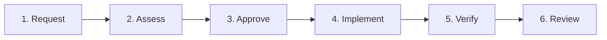
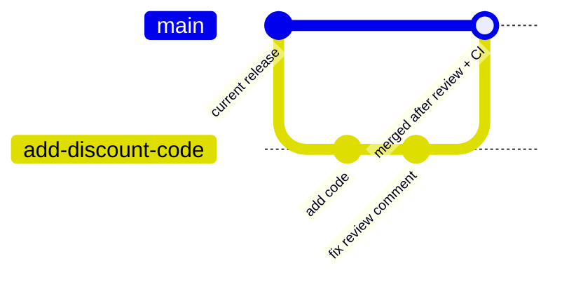

# Change Management in Cloud Engineering and DevOps

Most production incidents start with a change: a deployment, a configuration edit, a new firewall rule, a library
upgrade. A system nobody touches tends to keep working. Teams still have to change their systems constantly, to fix
bugs, ship features and patch security holes, so the question is how to change things often without each change
being a gamble.

**Change management** is the set of practices that answers that question: how a change is proposed, checked,
approved, made, and confirmed to have worked.

## Contents

1. [Why Change Management Matters](#1-why-change-management-matters)
2. [What Counts as a Change](#2-what-counts-as-a-change)
3. [Principles of Safe Change](#3-principles-of-safe-change)
4. [The Change Lifecycle](#4-the-change-lifecycle)
5. [Traditional and Modern Approaches](#5-traditional-and-modern-approaches)
6. [How Changes Flow Through Git](#6-how-changes-flow-through-git)
7. [Releasing a Change Safely](#7-releasing-a-change-safely)
8. [Measuring How Well You Manage Change](#8-measuring-how-well-you-manage-change)
9. [Common Challenges](#9-common-challenges)
10. [Check Your Understanding](#check-your-understanding)
11. [Further Learning](#further-learning)

---

## 1. Why Change Management Matters

When changes are poorly managed, the costs show up quickly:

- **Downtime.** A bad deployment or a mistyped setting takes a service down, and every minute of it costs revenue
  and trust.
- **Security gaps.** Rushed changes open ports, widen permissions or ship vulnerable code.
- **Slow recovery.** If nobody knows what changed, finding the cause of an outage takes far longer than fixing it.
- **Fear of change.** After a few painful releases, teams release less often, so each release gets bigger and
  riskier.

Managed well, the picture flips: changes are small and routine, problems are caught before users see them, and when
something does break, the team knows exactly what changed and how to undo it.

## 2. What Counts as a Change

Anything that alters how a running system behaves:

| Kind of change | Examples | How it can go wrong |
|---|---|---|
| Application code | A new feature, a bug fix | A bug reaches users |
| Configuration | Environment variables, ConfigMaps, feature flag settings | A wrong value takes a service down with no code changed |
| Infrastructure | A new subnet, a resized instance, a security group rule | A replaced resource loses its data; a rule blocks traffic |
| Dependencies | Upgrading a library, a base image, a Terraform provider | A breaking change in someone else's code |
| Data | Database schema migrations | Old code can't read the new schema |
| Access | IAM policies, Kubernetes RBAC roles | Too little access breaks a service; too much is a security hole |
| Process | A new CI pipeline, a new monitoring tool, a team reorganisation | Steps get skipped or nobody owns a task |

The earlier weeks gave you ways to manage most of these as code: Terraform for infrastructure, Dockerfiles and
lockfiles for dependencies, and Kubernetes manifests for configuration and access. Once a change is code, it can be
reviewed, tested and rolled back like code.

## 3. Principles of Safe Change

**Plan before you act.** Before making a change, answer four questions: what will it affect, what could go wrong,
how will we know it worked, and how do we undo it?

**Keep changes small.** A ten-line change gets a real review; a two-thousand-line change gets skimmed. When a small
change breaks something, the cause is obvious and the rollback is cheap.

**Make every change traceable.** Record who made it, when, why, and who approved it. Git history and pull requests
do this automatically, as long as changes go through them. A change made by hand in a console has no record: the
drift you saw in Week 1.

**Get a second pair of eyes.** Review catches mistakes and means at least two people understand every change.

**Automate the checks.** People forget steps and get tired; automated tests and builds give the same answer every
time. That's what continuous integration does (see the [CI platforms guide](./ci_platforms_guide.md)).

**Test somewhere that looks like production.** A change that works on a laptop can still fail against real
configuration and real data. Staging environments exist to close that gap.

**Make it reversible.** Know how you'd roll back before you roll forward. Changes that can't be undone, such as
deleting data, need extra care.

**Watch it after it lands.** A change isn't finished when it's deployed. Check that error rates, response times and
business numbers still look normal.

## 4. The Change Lifecycle

Whatever the tooling, a change goes through the same stages:

| Stage | Questions it answers | Typical evidence |
|---|---|---|
| 1. Request | What do we want to change, and why? | A ticket or issue, a pull request description |
| 2. Assess | What does it affect? How risky is it? How do we test and undo it? | Impact notes, a Terraform plan, test results |
| 3. Approve | Is it safe to go ahead? | A review approval, passing automated checks |
| 4. Implement | Make the change, ideally automatically | A pipeline run, a deployment log |
| 5. Verify | Did it work? Is the system still healthy? | Smoke tests, dashboards, alerts staying quiet |
| 6. Review | What did we learn? | Updated runbooks; a blameless post-incident review if it went wrong |

## 5. Traditional and Modern Approaches

### The traditional approach: change advisory boards

IT service management frameworks such as **ITIL** sort changes by risk:

| Type | Meaning | How it's approved |
|---|---|---|
| Standard | Low risk, done often, follows a known procedure | Pre-approved |
| Normal | Anything else | Assessed and approved in advance, often by a **Change Advisory Board (CAB)** |
| Emergency | Needed right now to fix an incident | Fast-tracked, reviewed afterwards |

A CAB is a group, often from outside the team, that meets regularly to approve changes. It adds waiting time, and
the people approving rarely know the change as well as the people who made it. Changes pile up between meetings, so
each release gets bigger.

### The modern approach: review and automation on every change

DevOps teams move the approval into the work itself:

- Every change is proposed as a **pull request**, so it's recorded and discussed in one place.
- A **teammate reviews** it: someone who understands the code.
- **Automated checks** (tests, builds, security scans) run on every change through a CI platform.
- The main branch is **protected**: nothing merges until the review and the checks pass.

The **DORA** research programme (section 8) found that requiring approval from an external body such as a CAB was
linked to slower delivery and was **not** linked to fewer failed changes. Peer review plus automated checks was.

Regulated organisations, such as banks and payment companies, must still prove to auditors that every change was
reviewed and approved. A protected branch gives them that proof automatically: who wrote the change, who approved
it, which checks passed, and when it merged. Many keep a lightweight change record for production releases, often
generated by the pipeline itself.

## 6. How Changes Flow Through Git

Git is the change log for everything kept as code: application code, Terraform, Dockerfiles, Kubernetes manifests,
and the pipelines themselves.

### Branches and pull requests

The most common flow, **GitHub Flow**, keeps `main` always releasable:

1. Create a short-lived branch for one change.
2. Commit the change, and open a **pull request** (a "merge request" on GitLab) describing what and why.
3. CI runs the checks; a teammate reviews.
4. Once the checks pass and the review is approved, merge into `main`.

Other strategies exist. **Trunk-based development** merges into `main` at least daily and hides unfinished work
behind feature flags; it suits teams with strong automated tests. **GitFlow** adds long-lived `develop` and `release`
branches; it suits software released as numbered versions on a schedule, such as mobile apps, and is usually more
process than a continuously deployed web service needs. Whichever a team picks, the habit that matters most is to
**integrate often**: a branch that lives for weeks drifts away from `main`, and merging it becomes a project of its
own.

### Protecting the main branch

Git platforms can enforce the process so nobody has to remember it. On GitHub these are **rulesets** (or branch
protection rules); GitLab has protected branches and approval rules. Typical rules:

- No direct pushes to `main`: changes arrive through pull requests.
- At least one approving review from someone other than the author.
- Named CI checks must pass before merging.
- No force pushes or deleting the branch, so history can't be rewritten.

### Good commit messages and versions

A commit message is read by whoever investigates a problem months later, so say what changed and why. Releases are
usually tagged with a **semantic version**, `MAJOR.MINOR.PATCH`: bump MAJOR for breaking changes, MINOR for new
features, PATCH for fixes. You relied on this in Week 2: `~> 6.0` on a provider accepts any `6.x`, but not `7.0`.

## 7. Releasing a Change Safely

**Deploying** puts new code on servers; **releasing** lets users use it. Keeping the two separate is how teams ship
often without betting everything on each deployment. These techniques limit how many users a bad change can reach:

| Technique | How it works | Rolling back |
|---|---|---|
| **Rolling update** | Replace instances a few at a time (Kubernetes Deployments, Week 4) | Roll the previous version out again |
| **Blue-green** | Run two identical environments; deploy to the idle one, then switch all traffic to it | Switch traffic back |
| **Canary** | Send a small share of traffic (say 5%) to the new version, watch it, then increase step by step | Send everyone back to the old version |
| **Feature flags** | Ship the code switched off, then turn it on for some or all users with a setting | Switch the flag off, no deployment needed |

When something does go wrong, a team either **rolls back** to the last version that worked, or **rolls forward** by
shipping a fix. Rolling back is usually faster during an incident; rolling forward is needed when going back isn't
possible, for example after a database migration that the old code can't work with.

To know whether a change worked at all, teams rely on **monitoring**: metrics (error rate, response time, CPU), logs
(records of individual events) and traces (one request's path through several services). Marking each deployment on
the dashboards makes it easy to see whether a problem started right after a change.

## 8. Measuring How Well You Manage Change

The **DORA** research programme (DevOps Research and Assessment, now part of Google Cloud) has surveyed tens of
thousands of professionals over more than a decade. It found that delivery performance can be measured with four
metrics, and that speed and stability go together: teams that deploy most often also fail least and recover fastest.

| Metric | Question | Measures |
|---|---|---|
| Deployment frequency | How often do we deploy to production? | Speed |
| Lead time for changes | How long from a commit to it running in production? | Speed |
| Change failure rate | What share of deployments cause a failure that needs fixing? | Stability |
| Failed deployment recovery time | When a deployment fails, how long until service is restored? | Stability |

Small changes, automated checks and quick rollbacks improve all four together.

## 9. Common Challenges

| Challenge | What helps |
|---|---|
| People resist a new process | Involve the team in designing it, start with a pilot, and show the time it saves |
| Process feels like bureaucracy | Automate the checks and records, so following the process is the easy path |
| Legacy systems can't be changed safely | Put them under version control first, add tests around the riskiest parts, and replace them piece by piece |
| Compliance rules slow everything down | Build the evidence auditors need (approvals, check results) into the pipeline |
| Changes span several teams | Agree on interfaces and owners, and announce changes that affect others before they ship |

---

## Check Your Understanding

1. Name four kinds of change other than application code, and how each could break production.
2. Why are small changes safer than large ones? Give two reasons.
3. Walk through the six stages of the change lifecycle for this change: "open port 443 on the web servers' security
   group".
4. What's a Change Advisory Board? What did the DORA research find about external approvals, and what works better?
5. How can a team in a regulated industry prove every change was approved, without a weekly approval meeting?
6. Your team keeps feature branches open for three weeks. What problems would you expect?
7. What's the difference between deploying and releasing? How do feature flags use that difference?
8. When would you roll forward instead of rolling back?
9. A team deploys once a month, and half its deployments cause an incident. Which DORA metrics show the problem, and
   what would you change first?

## Further Learning

- [DORA research](https://dora.dev/research/)
- [Atlassian: Change management in an ITSM and DevOps world](https://www.atlassian.com/itsm/change-management)
- [GitHub Docs: GitHub flow](https://docs.github.com/en/get-started/using-github/github-flow)
- [GitHub Docs: About rulesets](https://docs.github.com/en/repositories/configuring-branches-and-merges-in-your-repository/managing-rulesets/about-rulesets)
- [Martin Fowler: Feature Toggles](https://martinfowler.com/articles/feature-toggles.html)
- [Martin Fowler: Blue Green Deployment](https://martinfowler.com/bliki/BlueGreenDeployment.html) and [Canary Release](https://martinfowler.com/bliki/CanaryRelease.html)
- [Semantic Versioning](https://semver.org/)
