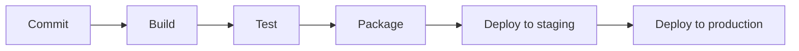
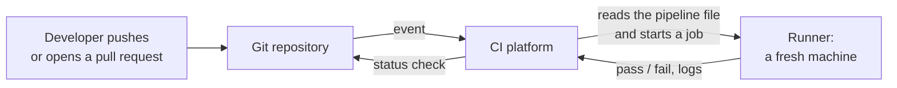

# Continuous Integration and CI Platforms

**Continuous integration (CI)** is the practice of merging everyone's work into the main branch often, at least
daily, and checking every change automatically with a build and tests. A **CI platform** is the service that runs
those checks: it notices a new change, starts a clean machine, runs the steps you defined, and reports the result
on the change.

This guide explains what CI is for, how CI platforms work, and how the main platforms compare. The
[change management guide](./change_management_guide.md) covers the process CI fits into. The
[hands-on demo](./hands-on-demo/) shows these ideas on GitHub Actions with a simulated pipeline, and next week you'll
build a real one.

## Contents

1. [Why Continuous Integration](#1-why-continuous-integration)
2. [CI, Continuous Delivery and Continuous Deployment](#2-ci-continuous-delivery-and-continuous-deployment)
3. [What a CI Pipeline Does](#3-what-a-ci-pipeline-does)
4. [How a CI Platform Works](#4-how-a-ci-platform-works)
5. [The Main CI Platforms](#5-the-main-ci-platforms)
6. [The Same Pipeline on Different Platforms](#6-the-same-pipeline-on-different-platforms)
7. [Choosing a Platform](#7-choosing-a-platform)
8. [Good Practices](#8-good-practices)
9. [Check Your Understanding](#check-your-understanding)
10. [Further Learning](#further-learning)

---

## 1. Why Continuous Integration

Without CI, developers work separately for days or weeks, then try to combine their work. By then the branches have
drifted apart: merges conflict, and the combined code fails in ways nobody's branch did on its own. Working out
which of fifty changes broke the build takes longer than writing them did.

CI makes integration small and constant:

- **Merge small changes often**, so each merge differs from `main` by a little.
- **Check every change automatically**, on a clean machine, the same way every time.
- **Fix a broken `main` first**, because everyone builds on top of it.

| Without CI | With CI |
|---|---|
| "It works on my machine" | It works on a clean machine, with the versions the project specifies |
| Bugs found days later, by someone else | Bugs found minutes after the push, by the person who wrote them |
| Reviewers run the tests themselves, or don't | Reviewers see the results on the pull request and focus on the logic |
| Nobody is sure `main` works | Every change on `main` passed the checks |

The practice matters more than the tool. A CI server that tests branches nobody merges for a month gives you
automated tests, but not continuous integration.

## 2. CI, Continuous Delivery and Continuous Deployment



- **Continuous integration** covers building and testing every change.
- **Continuous delivery** adds packaging and deploying, so every change that passes is *ready* for production. A
  person decides when it goes out.
- **Continuous deployment** removes that decision: every change that passes goes to production automatically.

"CI/CD" usually means the whole chain. Next week's hands-on class builds it.

## 3. What a CI Pipeline Does

A **pipeline** is the list of steps a CI platform runs for each change. The fast, cheap checks go first, so a
problem is reported as early as possible.

| Stage | What happens | Examples |
|---|---|---|
| Trigger | Something starts the pipeline | A push, a pull request, a schedule, a button |
| Checkout | A clean machine gets the exact commit | `git clone` of that commit |
| Install | Install the language and dependencies, at the locked versions | `pip install -r requirements.txt`, `npm ci` |
| Static checks | Find problems by reading the code, without running it | Linters (`ruff`, `eslint`), format checks, `terraform validate` |
| Test | Run the automated tests | `pytest`, `jest`, `go test` |
| Build | Produce what you'd deploy | A Docker image, a compiled binary, a website bundle |
| Report | Show the result on the change, and keep logs and reports | A green tick or red cross on the pull request |

Most automated tests should be **unit tests**, which check one small piece of code on its own and run in
milliseconds. A smaller number of **integration tests** check that parts work together, for example the API with a
real database. A few **end-to-end tests** exercise the whole system the way a user would; they're slow, so there are
few of them.

## 4. How a CI Platform Works



Every platform is built from the same parts, under different names:

| Idea | What it means | GitHub Actions | GitLab CI | Jenkins |
|---|---|---|---|---|
| Pipeline definition | The file listing what to run | Workflow (`.github/workflows/*.yml`) | Pipeline (`.gitlab-ci.yml`) | Pipeline (`Jenkinsfile`) |
| Trigger | What starts it | Event (`on:`) | Rules, pipeline sources | Triggers, webhooks |
| Job | A group of steps on one machine | Job | Job | Stage |
| Step | One command or reusable task | Step | Script line | Step |
| Runner | The machine that runs a job | Runner | Runner | Agent |
| Reusable building block | Shared steps others published | Action | Component, template | Plugin, shared library |
| Secret | A password or token the pipeline needs | Secret | CI/CD variable (masked) | Credential |
| Artifact | A file kept after the job ends | Artifact | Artifact | Archived artifact |

### Pipeline as code

All the modern platforms read the pipeline from a file in the repository. The pipeline is versioned with the code
it checks, reviewed in pull requests, and can be rolled back. Older setups configured pipelines through a web
interface, where changes left no history: the same problem as ClickOps in Week 1.

### Hosted and self-hosted runners

| | Hosted runners | Self-hosted runners |
|---|---|---|
| Who runs the machine | The platform | You |
| Setup | None | Install an agent on your own machine or cluster |
| Each job gets | A fresh virtual machine, thrown away afterwards | Whatever you configure (often a reused machine) |
| Cost | Per minute (free allowances; GitHub Actions is free for public repositories) | Your own infrastructure costs |
| Use when | Most of the time | Jobs must reach a private network, need special hardware (GPUs), or run so much that hosted minutes get expensive |

### Status checks

When a job finishes, the platform reports its result on the commit or pull request, as a **status check**. On its
own, a failed check is only information. Once the repository's rules **require** that check, the platform blocks the
merge until it passes. That link between CI and branch protection is what makes "every change on `main` was tested"
true.

## 5. The Main CI Platforms

| Platform | Hosted by | Pipeline file | Strengths | Trade-offs |
|---|---|---|---|---|
| **GitHub Actions** | GitHub, or your own runners | `.github/workflows/*.yml` | Built into GitHub; a large marketplace of reusable actions; free for public repositories | Only for repositories on GitHub |
| **GitLab CI/CD** | GitLab, or self-managed | `.gitlab-ci.yml` | Built into GitLab with planning, registry and security tools in one product; strong self-hosting | Best value when the whole team uses GitLab |
| **Jenkins** | You | `Jenkinsfile` | Open source, runs anywhere, plugins for almost everything | You maintain the server, its plugins and its security |
| **Bitbucket Pipelines** | Atlassian | `bitbucket-pipelines.yml` | Built into Bitbucket, links to Jira | Smaller ecosystem |
| **CircleCI** | CircleCI, or your own runners | `.circleci/config.yml` | Works with GitHub and Bitbucket; speed features such as test splitting | A separate service to manage |
| **Azure Pipelines** | Microsoft | `azure-pipelines.yml` | Part of Azure DevOps; strong Windows and .NET support | Most at home in Microsoft environments |
| **AWS CodeBuild / CodePipeline** | AWS | `buildspec.yml` | Runs inside your AWS account, with IAM permissions | AWS only; less convenient for everyday pull request checks |

Tools such as **Argo CD** and **Flux** are often mentioned alongside these. They aren't CI platforms: they handle
the deployment side, keeping a Kubernetes cluster in line with what's in Git (an approach called GitOps).

## 6. The Same Pipeline on Different Platforms

The same three steps, install, test and build an image, for a small Python app. The syntax differs; the idea
doesn't.

**GitHub Actions** (`.github/workflows/ci.yml`):

```yaml
name: CI
on:
  push:
    branches: [main]
  pull_request:

jobs:
  test:
    runs-on: ubuntu-latest
    steps:
      - uses: actions/checkout@v7
      - uses: actions/setup-python@v7
        with:
          python-version: "3.13"
      - run: pip install -r requirements.txt
      - run: pytest

  build:
    needs: test                     # only after the tests pass
    runs-on: ubuntu-latest
    steps:
      - uses: actions/checkout@v7
      - run: docker build -t my-app:${{ github.sha }} .
```

**GitLab CI/CD** (`.gitlab-ci.yml`):

```yaml
stages: [test, build]

test:
  stage: test
  image: python:3.13-slim
  script:
    - pip install -r requirements.txt
    - pytest

build:
  stage: build
  image: docker:29
  services: [docker:29-dind]
  variables:
    DOCKER_TLS_CERTDIR: "/certs"
  script:
    - docker build -t my-app:$CI_COMMIT_SHA .
```

**Jenkins** (`Jenkinsfile`, on an agent with Python and Docker installed):

```groovy
pipeline {
  agent any
  stages {
    stage('Test') {
      steps {
        sh 'pip install -r requirements.txt'
        sh 'pytest'
      }
    }
    stage('Build') {
      steps {
        sh 'docker build -t my-app:${GIT_COMMIT} .'
      }
    }
  }
}
```

**Bitbucket Pipelines** (`bitbucket-pipelines.yml`):

```yaml
image: python:3.13-slim

pipelines:
  default:
    - step:
        name: Test
        script:
          - pip install -r requirements.txt
          - pytest
    - step:
        name: Build
        services: [docker]
        script:
          - docker build -t my-app:$BITBUCKET_COMMIT .
```

Things to notice:
- Every version checks out the code, installs dependencies, tests, then builds, in that order.
- The build is tagged with the **commit ID**, so every image can be traced back to the exact code it came from.
- GitLab and Bitbucket run each job inside a container image you name. GitHub Actions starts a virtual machine.
  Jenkins runs on agents you set up and maintain yourself.

## 7. Choosing a Platform

Most teams start with the platform built into where their code lives, and only look further when they have a
reason to:

| Situation | Usual choice |
|---|---|
| Code on GitHub | GitHub Actions |
| Code on GitLab, or a self-hosted all-in-one platform is wanted | GitLab CI/CD |
| Code on Bitbucket, team uses Jira | Bitbucket Pipelines |
| Strict rules that everything runs on your own servers, or unusual build needs | Jenkins, or self-hosted runners of the above |
| Heavy Microsoft stack | Azure Pipelines |
| Everything must stay inside an AWS account | AWS CodeBuild / CodePipeline |

Questions worth asking:
- **Where is the code?** Built-in platforms show results on pull requests with no extra setup.
- **Who maintains it?** A hosted platform needs no servers; Jenkins needs someone to patch and secure it.
- **What does it cost?** Minutes per month, the machine sizes you need, and the time spent maintaining it.
- **What must jobs reach?** Private networks or special hardware point to self-hosted runners.
- **What does the team already know?** The concepts carry over between platforms, but switching still takes effort.

## 8. Good Practices

- **Keep it fast.** Aim for a few minutes. Cache dependencies, run independent jobs in parallel, and put the quick
  checks first.
- **Keep it reliable.** A **flaky test** passes and fails on the same code. Every false alarm teaches people to
  re-run without reading the logs, so fix flaky tests quickly.
- **Make it reproducible.** Install from lockfiles, pin tool and image versions, and don't rely on anything left over
  from a previous run.
- **Make failures easy to reproduce.** The commands in the pipeline should be commands a developer can run on a
  laptop.
- **Require the checks.** A check that can be ignored will be. Make the important ones required before merging.
- **Protect secrets.** Store passwords and tokens in the platform's secret store, never in the repository, and give
  pipelines only the permissions they need.
- **Fix a red `main` first.** If the main branch is broken, everyone's work is built on a broken base.

---

## Check Your Understanding

1. In your own words, what is continuous integration, and what problem does it solve?
2. What's the difference between continuous delivery and continuous deployment?
3. Put these pipeline stages in a sensible order and explain why: build an image, run unit tests, install
   dependencies, run the linter.
4. What's a runner? When would a team choose self-hosted runners over hosted ones?
5. What does "pipeline as code" mean, and why is it better than configuring a pipeline in a web interface?
6. A check fails on a pull request, but the merge button still works. Why, and how do you change that?
7. Using the examples in section 6, name one thing that's the same and one that's different between GitHub Actions
   and Jenkins.
8. Your company keeps its code on GitLab, but one team wants to use GitHub Actions. What would you ask before
   agreeing?
9. A pipeline takes 30 minutes and fails randomly about once a day. What would you look at first?

## Further Learning

- [Martin Fowler: Continuous Integration](https://martinfowler.com/articles/continuousIntegration.html)
- [GitHub Docs: Understanding GitHub Actions](https://docs.github.com/en/actions/get-started/understand-github-actions)
- [GitLab Docs: Get started with GitLab CI/CD](https://docs.gitlab.com/ci/)
- [Jenkins: Pipeline](https://www.jenkins.io/doc/book/pipeline/)
- [Bitbucket Pipelines](https://support.atlassian.com/bitbucket-cloud/docs/get-started-with-bitbucket-pipelines/)
- [CircleCI: Concepts](https://circleci.com/docs/guides/about-circleci/concepts/)
