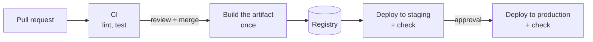
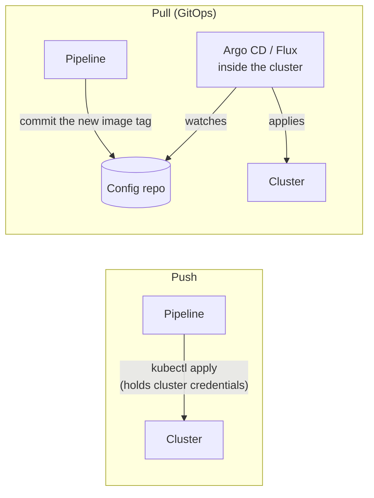
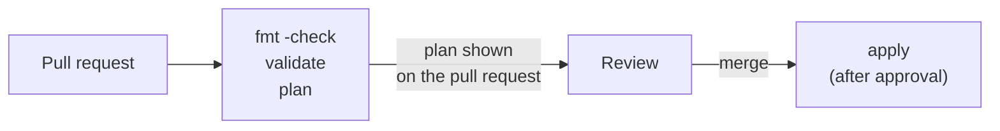

# Building CI/CD Pipelines

Week 6 covered what continuous integration is and how CI platforms work. This guide takes the next step: turning a
CI workflow into a pipeline that **delivers** a change, from a pull request to a running server. The examples use
GitHub Actions, as in the [hands-on demo](./hands-on-demo/), but the ideas carry over to any platform.

## Contents

1. [From CI to CD](#1-from-ci-to-cd)
2. [Workflows in More Depth](#2-workflows-in-more-depth)
3. [Secrets, Variables and the Run's Token](#3-secrets-variables-and-the-runs-token)
4. [Build Once, Deploy Many](#4-build-once-deploy-many)
5. [Environments and Promotion](#5-environments-and-promotion)
6. [Ways to Deploy](#6-ways-to-deploy)
7. [Credentials for the Cloud](#7-credentials-for-the-cloud)
8. [Checking a Deployment and Rolling Back](#8-checking-a-deployment-and-rolling-back)
9. [Pipelines for Infrastructure Code](#9-pipelines-for-infrastructure-code)
10. [Good Practices](#10-good-practices)
11. [Troubleshooting](#11-troubleshooting)
- [Check Your Understanding](#check-your-understanding)
- [Further Learning](#further-learning)

---

## 1. From CI to CD

CI answers *"is this change good?"* CD answers *"how does a good change reach users?"* A typical pipeline:



- **Pull requests run CI only.** Nothing is deployed until the change has been reviewed and merged.
- **A merge to `main` starts delivery.** The artifact (here, a Docker image) is built once and stored.
- **The same artifact moves through the environments.** Staging first, then production.
- **Each deployment is checked.** The pipeline confirms the new version answers before it calls the job a success.

Whether production needs a person's approval is the difference from Week 6:

| | Every merge reaches production... |
|---|---|
| **Continuous delivery** | ...after someone approves it. It's always *ready* to release |
| **Continuous deployment** | ...automatically, if every check passes |

Most teams start with delivery, and move to deployment as their tests and monitoring earn their trust.

## 2. Workflows in More Depth

### Events and filters

```yaml
on:
  push:
    branches: [main]            # changes that landed on main
  pull_request:                 # pull requests, opened or updated
  workflow_dispatch:            # a "Run workflow" button
  schedule:
    - cron: "0 6 * * 1"         # Mondays at 06:00 UTC
```

`paths` limits a workflow to changes in some files. Useful when a repository holds an app and its infrastructure:

```yaml
on:
  pull_request:
    paths: ["infra/**"]
```

### Jobs, dependencies and conditions

```yaml
jobs:
  test:
    runs-on: ubuntu-latest
    steps: [...]
  build:
    needs: test                                # waits for test, skipped if test fails
    if: github.event_name == 'push'            # pushes to main only, never pull requests
    runs-on: ubuntu-latest
    steps: [...]
```

`needs` and `if` together are how one workflow file does CI on pull requests and CD on `main`. Jobs without
`needs` run in parallel. `timeout-minutes` stops a stuck job; the default is 6 hours.

### Passing values between jobs

Each job runs on its own machine, so a value one job works out has to be handed over explicitly. A step writes it to
`$GITHUB_OUTPUT`, the job declares it under `outputs`, and later jobs read it from `needs`:

```yaml
build:
  outputs:
    image: ${{ steps.name.outputs.image }}
  steps:
    - id: name
      run: echo "image=ghcr.io/${GITHUB_REPOSITORY,,}:${GITHUB_SHA}" >> "$GITHUB_OUTPUT"

deploy:
  needs: build
  steps:
    - run: echo "Deploying ${{ needs.build.outputs.image }}"
```

For files (a compiled binary, a report), use **artifacts** instead: `actions/upload-artifact@v7` in one job,
`actions/download-artifact@v8` in the next.

### Expressions and contexts

`${{ ... }}` is filled in by GitHub when the run starts:

| Expression | Value |
|---|---|
| `github.sha` | The commit being built |
| `github.ref_name` | The branch or tag |
| `github.event_name` | `push`, `pull_request`, ... |
| `github.actor` | Who started the run |
| `github.repository` | `owner/repo` |
| `needs.<job>.outputs.<name>` | An output of an earlier job |
| `vars.NAME`, `secrets.NAME` | A variable or a secret (next section) |

Inside `run:` scripts, most of these are also environment variables: `$GITHUB_SHA`, `$GITHUB_REPOSITORY`, and so on.

### Caching

A cache saves files between runs, usually downloaded dependencies, keyed by a hash of the lockfile:

- Setup actions often do it for you: `astral-sh/setup-uv` caches uv's downloads, `actions/setup-node` has
  `cache: npm`.
- `actions/cache@v6` caches any folder you name.
- Docker layers: `cache-from: type=gha` and `cache-to: type=gha,mode=max` on `docker/build-push-action`.

A run can use caches from its own branch and from the default branch. Caches speed things up; artifacts keep
results. Don't use one for the other.

### Matrix builds

The same job, once for each combination of values, in parallel:

```yaml
test:
  strategy:
    matrix:
      python-version: ["3.13", "3.14"]
  steps:
    - uses: astral-sh/setup-uv@v10.3.3
      with:
        python-version: ${{ matrix.python-version }}
```

The checks are then named `test (3.13)` and `test (3.14)`: required checks in a ruleset must use those names.

### Concurrency

```yaml
concurrency:
  group: deploy-production
  cancel-in-progress: false
```

Only one run in a `group` at a time. On pull requests, cancelling the old run saves time. On deployments, **don't**
cancel: stopping a deployment halfway can leave a server with no app running. Queue the next one instead.

### Reusing workflow code

When several jobs repeat the same steps, like the demo's two deploy jobs, there are two ways to share them:

- A **reusable workflow** (`on: workflow_call`) is a whole workflow that another one calls like a job, with inputs
  and secrets.
- A **composite action** is a group of steps in an `action.yml`, used like any other action with `uses:`.

Repetition is fine while a pipeline is small and easy to read. Reach for these once a copy gets out of sync.

## 3. Secrets, Variables and the Run's Token

| | Set where | Read in a workflow | Visible? |
|---|---|---|---|
| **Secret** | Settings → Secrets and variables → Actions, or `gh secret set` | `${{ secrets.NAME }}` | Never shown again after saving; masked as `***` in logs |
| **Variable** | Same page, **Variables** tab, or `gh variable set` | `${{ vars.NAME }}` | Plain text |
| **`GITHUB_TOKEN`** | Created by GitHub for each run | `${{ secrets.GITHUB_TOKEN }}` | Expires when the job ends |

Both secrets and variables can be set for the whole repository, or for one **environment** (section 5).

Handle secrets with care:
- Pass them to the **step** that needs them, through `env:`, not to the whole workflow.
- Never `echo` them. Masking only catches the exact value: a secret that's base64-encoded, or split up, is printed
  in full.
- Pull requests from forks don't get secrets, so a stranger can't open a pull request that prints them.

`GITHUB_TOKEN` can act on the repository: read code, push images to GitHub's registry, comment on pull requests.
Give it only what each job needs with `permissions:`. Anything not listed is denied:

```yaml
permissions:
  contents: read            # the whole workflow: read the code

jobs:
  build:
    permissions:
      contents: read
      packages: write       # this job also pushes images
```

## 4. Build Once, Deploy Many

Build the artifact **once**, then deploy that same artifact to every environment. If you rebuild for production,
you deploy something you never tested: dependencies may have moved, or the base image changed overnight.

For containers, the artifact is an **image** in a **registry**:

| Registry | Notes |
|---|---|
| GitHub Container Registry (`ghcr.io`) | Next to the code; a workflow logs in with `GITHUB_TOKEN`, no extra secret |
| Docker Hub | The public default; free accounts have pull limits |
| Amazon ECR, Google Artifact Registry, Azure Container Registry | In the same cloud as the servers that pull from them |

**Tag images so you can tell what's inside:**
- The **commit SHA** (`shop-api:3f9c2e1...`): every image traces back to exact code, and every deployment is a
  known version.
- A **release version** (`shop-api:1.4.0`) when you publish releases (semantic versioning, Week 6).
- `latest` says nothing about what's inside, and changes under you. Don't deploy it.

Keep old images for a while: they're what a rollback deploys.

## 5. Environments and Promotion

An **environment** is a place the app runs, such as `staging` or `production`. In GitHub Actions, it's also a
setting on a job:

```yaml
deploy-production:
  environment:
    name: production
    url: https://shop.example.com
```

That one line gives the job:
- the environment's own **variables and secrets**, so the same steps deploy to different servers with different
  settings;
- its **protection rules**, checked before the job starts;
- a record in the repository's **Deployments** list: which version is live where, and since when.

| Protection rule | What it does |
|---|---|
| **Required reviewers** | The job waits until a listed person approves it. Up to 6 people or teams; any one can approve |
| **Prevent self-review** | The person who started the run can't approve it |
| **Wait timer** | The job waits a set number of minutes first, for example to watch staging's metrics |
| **Deployment branches and tags** | Only runs from these branches can deploy, so a feature branch can't deploy to production |

**Promotion** is moving a tested version to the next environment. A version only reaches production after it ran
on staging, and the approval is recorded with who approved it and when. That's the change approval from Week 6,
built into the pipeline.

**Keep environments alike.** Staging is only a useful rehearsal if it matches production: same image, same
configuration shape, similar data and infrastructure. Differences belong in environment variables, not in different
code.

## 6. Ways to Deploy

The last step of the pipeline depends on where the app runs.

| Target | How the pipeline deploys |
|---|---|
| **A virtual machine** (the demo) | Connect over SSH, pull the new image, replace the container |
| **Kubernetes** (Weeks 4 and 5) | `kubectl set image` or `kubectl apply`, or `helm upgrade`. Kubernetes then does a rolling update |
| **A managed container service** (Amazon ECS, Google Cloud Run, Azure Container Apps) | Call the service's API or CLI with the new image |
| **Serverless functions** (AWS Lambda) | Upload the new code or image and switch the function to it |
| **A static site** (GitHub Pages, S3 + CloudFront) | Upload the built files |

### Push and pull deployments

Every target above is a **push** deployment: the pipeline reaches into the environment and changes it, so it needs
credentials for that environment.

**GitOps** turns it around. An agent inside the cluster, such as **Argo CD** or **Flux**, watches a Git repository
of manifests and **pulls** changes in:



With GitOps, the pipeline only needs to commit to a repository. The cluster's credentials never leave the cluster,
the Git history is the record of every deployment, and a rollback is a `git revert`.

## 7. Credentials for the Cloud

A pipeline that deploys to AWS, or runs `terraform apply`, needs AWS credentials. There are two ways to give them.

**Long-lived access keys in secrets.** Create an IAM user, store its access key as `AWS_ACCESS_KEY_ID` and
`AWS_SECRET_ACCESS_KEY` secrets. Simple, but the keys work from anywhere until someone rotates them, and a leaked
key is a leaked account.

**Short-lived credentials with OIDC (preferred).** GitHub gives each run a signed token that says which repository,
branch and environment it is running for. AWS is set up to trust GitHub's tokens, and swaps one for temporary
credentials for an IAM role, valid for about an hour. There's no stored secret to leak.

```yaml
permissions:
  id-token: write           # allow the job to request the signed token
  contents: read

steps:
  - uses: aws-actions/configure-aws-credentials@v6
    with:
      role-to-assume: arn:aws:iam::123456789012:role/github-deploy
      aws-region: us-east-1
  - run: aws sts get-caller-identity     # now signed in as the role
```

The role's **trust policy** decides which runs can use it, for example only `repo:my-org/shop-api:environment:production`.
GitLab, Azure and Google Cloud support the same idea.

## 8. Checking a Deployment and Rolling Back

A deployment isn't done when the command finishes. It's done when the new version works.

**Check it:**
- **A smoke test** right after deploying: call a health endpoint and confirm it reports the **new version**, as the
  demo's `Check the deployment` step does. A server that answers with the old version means the deploy didn't take.
- **Health checks** in the platform itself: Kubernetes readiness probes (Week 5) keep traffic away from a pod
  until it's ready.
- **Watch the metrics** for a while: error rate, latency. A canary release (Week 6) does this with a small share
  of users first.

**Roll back** when it's wrong:

| Option | How | When |
|---|---|---|
| Redeploy the previous version | Re-run an earlier deployment, or deploy the previous image tag | Fastest; works because old images are kept |
| Platform rollback | `kubectl rollout undo`, or switching a blue-green release back | When the platform keeps the previous version running or recorded |
| Turn off a feature flag | Flip the flag | When the change was released behind a flag |
| Roll forward | Merge a fix, or a `git revert`, through the pipeline | The lasting fix, once you know the cause |

Rolling back the code doesn't roll back data. A database migration that drops a column can't be undone by
deploying an older image, so make database changes backwards compatible: add the new column first, change the code,
remove the old column in a later release.

## 9. Pipelines for Infrastructure Code

Terraform changes get the same treatment as app changes, and arguably need it more: a bad change can delete a
database.



- **On every pull request**: `terraform fmt -check`, `terraform validate`, then `terraform plan`. Reviewers read the
  plan, not just the code: it shows exactly what will be created, changed or **destroyed**.
- **After merging**: `terraform apply` in a job with `environment: production`, so a person approves it.
- **Remote state with locking** (Week 2) is required, so two runs can't change the same infrastructure at once.

```yaml
plan:
  runs-on: ubuntu-latest
  permissions:
    id-token: write
    contents: read
  defaults:
    run:
      working-directory: infra
  steps:
    - uses: actions/checkout@v7
    - uses: hashicorp/setup-terraform@v4
    - uses: aws-actions/configure-aws-credentials@v6
      with:
        role-to-assume: ${{ vars.AWS_PLAN_ROLE }}
        aws-region: us-east-1
    - run: terraform fmt -check -recursive
    - run: terraform init
    - run: terraform validate
    - run: terraform plan -no-color
```

Tools such as **Atlantis**, **HCP Terraform** and **Spacelift** add plan comments, locking and approvals on top of
this.

## 10. Good Practices

- **One pipeline, CI and CD together.** Pull requests run the checks; merges also build and deploy.
- **Build once, promote the same artifact.** Tag it with the commit.
- **Fail early and loudly.** Quick checks first; stop at the first failed stage; never deploy if a check failed.
- **Keep deployments small and frequent.** A small change is easy to check, and easy to roll back.
- **Check every deployment**, and have a rollback you've actually tried.
- **Least privilege everywhere.** `permissions:` on every workflow, secrets only to the steps that need them,
  short-lived cloud credentials, and a deploy key that only reaches its server.
- **Protect production.** Required reviewers, deployment branches, and one deployment at a time (`concurrency`).
- **Keep the pipeline readable.** It's code someone else will debug during an incident. Clear job and step names,
  no clever YAML.

## 11. Troubleshooting

| Problem | Likely cause and fix |
|---|---|
| The deploy jobs never run | They have `if: github.event_name == 'push'` and the run is a pull request, or a job they `need` failed or was skipped |
| A job is stuck on **Waiting** | The environment has required reviewers: approve it under **Review deployments** |
| `Resource not accessible by integration`, or `denied` pushing an image | The job's `permissions:` don't include what it needs, such as `packages: write` |
| A secret or variable is empty | A typo in the name, it's set on a different environment, or the run comes from a fork |
| `needs.build.outputs.image` is empty | The job doesn't list `build` under `needs`, or `build` didn't declare the output under `outputs` |
| `Permission denied (publickey)` | The secret doesn't hold the private key that matches the server's authorised key |
| The new version deployed but the old one still answers | The old container wasn't replaced, or the check hit a different port. The version on `/health` tells you which one is live |
| `Could not assume role` with OIDC | The job lacks `permissions: id-token: write`, or the role's trust policy doesn't match the repository, branch or environment |

---

## Check Your Understanding

1. A pull request and a merge to `main` both start the demo's pipeline. Which jobs run for each, and what in the
   workflow decides that?
2. Why build the image once and promote it, instead of building it again for production?
3. Why is `latest` a poor tag to deploy? What do you use instead?
4. What's the difference between a secret, a variable and the `GITHUB_TOKEN`?
5. The demo's two deploy jobs have identical steps but deploy to different ports. How?
6. What does a required reviewer on an environment give you? How does it relate to Week 6's change approval?
7. Explain the difference between a push deployment and GitOps. Which one needs cluster credentials in the CI
   platform?
8. Why are OIDC credentials safer than access keys stored as secrets?
9. Production breaks after a deployment. Describe two ways to get the previous version back, and why neither is the
   end of the story.
10. What should a pipeline for Terraform run on a pull request, and what after merging?

## Further Learning

- [GitHub Docs: Workflow syntax](https://docs.github.com/en/actions/reference/workflows-and-actions/workflow-syntax)
- [GitHub Docs: Managing environments for deployment](https://docs.github.com/en/actions/how-tos/deploy/configure-and-manage-deployments/manage-environments)
- [GitHub Docs: Using secrets in GitHub Actions](https://docs.github.com/en/actions/how-tos/write-workflows/choose-what-workflows-do/use-secrets)
- [GitHub Docs: Publishing Docker images](https://docs.github.com/en/actions/tutorials/publish-packages/publish-docker-images)
- [GitHub Docs: Configuring OpenID Connect in Amazon Web Services](https://docs.github.com/en/actions/how-tos/secure-your-work/security-harden-deployments/oidc-in-aws)
- [Martin Fowler: Continuous Delivery](https://martinfowler.com/bliki/ContinuousDelivery.html)
- [Argo CD: Getting started](https://argo-cd.readthedocs.io/en/stable/getting_started/)
- [HashiCorp: Automate Terraform with GitHub Actions](https://developer.hashicorp.com/terraform/tutorials/automation/github-actions)
