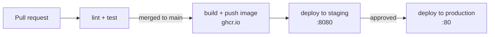

# CI/CD Hands-On Demo: From Pull Request to Production

This folder holds a small **Shop Pricing API** (FastAPI): send it a basket and a discount code, and it returns the
subtotal, discount, shipping and total. It comes with tests, a linter and a Dockerfile.

We connect it to a pipeline in **GitHub Actions**, then extend that pipeline until a merged pull request ends up
running on a server:



1. Put the app on GitHub
2. CI: lint and test every change
3. Protect `main`
4. Create the server
5. Connect the pipeline to the server: secrets, variables and environments
6. CD: build, push and deploy
7. Ship a change
8. Roll back
9. Cleanup

## Prerequisites

- A **GitHub account**, **`git`**, and the **GitHub CLI** signed in (`gh auth login`)
- **`uv`** ([install guide](https://docs.astral.sh/uv/getting-started/installation/))
- An **AWS account**, the **AWS CLI** signed in, and **Terraform** (Weeks 1 and 2)
- **`ssh-keygen`** and **`curl`** (already on macOS and Linux; on Windows use WSL)

> **The repository must be public.** On GitHub's free plan, rulesets (Step 3) and environment approvals (Step 5)
> only work on public repositories.

## Files

| Path | Purpose |
|---|---|
| `pricing.py`, `main.py` | The app: pricing rules, and the API (`GET /health`, `POST /quote`) |
| `tests/` | Unit tests for the rules, and API tests |
| `pyproject.toml`, `uv.lock`, `.python-version` | Dependencies, dev tools (pytest, ruff) and their settings |
| `Dockerfile`, `.dockerignore` | The multi-stage image from Week 3 |
| `workflows/01-ci.yml` | Stage 1: lint and test every change |
| `workflows/02-cicd.yml` | Stage 2: stage 1, plus build, push and deploy to staging and production |
| `rulesets/protect-main.json` | Protects `main`: pull requests only, and `lint` and `test` must pass |
| `server/main.tf` | One EC2 server with Docker. Staging runs on port 8080, production on port 80 |

GitHub only runs workflows from `.github/workflows/` at the **root** of a repository. The files in `workflows/`
are the stages: at each step we copy one of them to `.github/workflows/pipeline.yml`.

---

## Step 1: Put the App on GitHub

Copy this folder somewhere **outside** the course repository, so it becomes a repository of its own:

```bash
cp -r . ~/shop-api && cd ~/shop-api
rm -rf .venv README*.md
git init -b main
git add .
git commit -m "Add the shop pricing API"
gh repo create shop-api --public --source . --push
```

From now on, commands run in `~/shop-api`. Check that the app works on your machine:

```bash
uv sync
uv run pytest                    # 13 passed
uv run ruff check .              # All checks passed!
```

---

## Step 2: CI, Lint and Test Every Change

```bash
mkdir -p .github/workflows
cp workflows/01-ci.yml .github/workflows/pipeline.yml
```

Walk through `pipeline.yml` (Week 6 introduced the parts):
- Two jobs, `lint` and `test`, run **in parallel** on fresh runners.
- `uv sync --locked`: install exactly what `uv.lock` says.
- `permissions: contents: read`: this run's token can read the code and nothing else.
- `concurrency`: a new push to the same branch cancels the run still checking the old commit.
- The test job uploads its report as an **artifact**, even when tests fail (`if: always()`).

```bash
git add .github
git commit -m "Lint and test in CI"
git push
gh run watch                     # pick the latest run
```

Open the run in the **Actions** tab. Under **Artifacts** there's `test-results`.

---

## Step 3: Protect `main`

So far a failing check is only advice. A **ruleset** makes the checks required.

In the browser: **Settings → Rules → Rulesets → New ruleset → New branch ruleset**:
- **Name**: `Protect main`. **Enforcement status**: **Active**
- **Target branches**: **Add target → Include default branch**
- Tick **Restrict deletions** and **Block force pushes**
- Tick **Require a pull request before merging** (required approvals: 0, since you can't approve your own pull
  request)
- Tick **Require status checks to pass**, then **Add checks**: `lint` and `test`
- **Create**

Or, with the same settings from the file:

```bash
gh api repos/{owner}/{repo}/rulesets -X POST --input rulesets/protect-main.json
```

Prove it with a change that breaks a test. On a branch, edit `pricing.py` and change `"SAVE20": 20` to
`"SAVE20": 25`:

```bash
git switch -c bigger-discount
git commit -am "Make SAVE20 take 25% off"
git push -u origin bigger-discount
gh pr create --title "Make SAVE20 take 25% off" --body "A change that breaks a test."
gh pr checks --watch             # lint: pass, test: fail
gh pr view --json mergeStateStatus      # "BLOCKED"
```

The **Merge** button is greyed out until `test` passes. Close the pull request without merging:

```bash
gh pr close --delete-branch
git switch main
```

---

## Step 4: Create the Server

One EC2 instance with Docker, for both environments. The pipeline logs in with an SSH key made just for it, a
**deploy key**:

```bash
ssh-keygen -t ed25519 -f ~/.ssh/shop-deploy -N "" -C "shop-api deploy key"
```

`-N ""` leaves it without a passphrase, because the pipeline can't type one. That's why it's a separate key that
can only reach this server, not your own.

```bash
cd server
terraform init
terraform apply                  # 3 to add: the key pair, a security group and the instance
terraform output
cd ..
```

Wait a minute or two for Docker to install, then check:

```bash
ssh -i ~/.ssh/shop-deploy ubuntu@<server_ip> docker ps
# CONTAINER ID   IMAGE   COMMAND   CREATED   STATUS   PORTS   NAMES   (empty: nothing deployed yet)
```

Answer `yes` to the host key question the first time.

---

## Step 5: Connect the Pipeline to the Server

The deploy jobs need three things that don't belong in the repository: the server's address, the private key, and a
rule that a person approves production deployments.

**Secrets and variables**: **Settings → Secrets and variables → Actions**. Or:

```bash
gh secret set SSH_PRIVATE_KEY < ~/.ssh/shop-deploy
gh variable set SERVER_HOST --body "$(terraform -chdir=server output -raw server_ip)"
```

- A **secret** is encrypted. Workflows can use it, but nobody can read it back, not even you, and GitHub hides its
  value in logs (`***`).
- A **variable** is plain text, for settings that aren't sensitive.

**Environments**: **Settings → Environments → New environment**:
1. `staging`. Under **Environment variables**, add `APP_PORT` = `8080`.
2. `production`. Tick **Required reviewers** and add yourself, **Save protection rules**. Add the variable
   `APP_PORT` = `80`.

Or from the terminal:

```bash
gh api -X PUT repos/{owner}/{repo}/environments/staging
gh api -X PUT repos/{owner}/{repo}/environments/production \
  -f "reviewers[][type]=User" -F "reviewers[][id]=$(gh api user -q .id)"
gh variable set APP_PORT --env staging --body 8080
gh variable set APP_PORT --env production --body 80
```

- `APP_PORT` has the same name in both environments, with a different value. A job that says
  `environment: staging` gets 8080; one that says `environment: production` gets 80. The same steps deploy to both.
- Environments can also hold their own secrets, for example a different key for each server.
- **Required reviewers** pause a job until someone approves it. That's the change approval from Week 6, recorded on
  the deployment.

---

## Step 6: CD, Build, Push and Deploy

`main` is protected, so even the pipeline's own change goes through a pull request.

```bash
git switch -c add-cd
cp workflows/02-cicd.yml .github/workflows/pipeline.yml
```

Walk through the new jobs:
- **`build`**: `needs: [lint, test]` and `if: github.event_name == 'push'`, so it only runs for changes that
  landed on `main`, never for a pull request. It builds the image **once** and pushes it to **GitHub's container
  registry** (`ghcr.io`), tagged with the commit SHA. It logs in with `GITHUB_TOKEN`, a token GitHub creates for
  each run, and `permissions: packages: write` lets it push.
- `outputs`: `build` hands the image's name to the deploy jobs.
- **`deploy-staging`**: `environment: staging` gives it staging's `APP_PORT`. It connects over SSH, has the server
  pull the image, replaces the container, then calls `/health` until the new version answers.
- **`deploy-production`**: the same steps, after staging, with `environment: production`. It waits for a
  reviewer.

```bash
git commit -am "Build, push and deploy on merge"
git push -u origin add-cd
gh pr create --title "Build, push and deploy on merge" --body "Adds CD to the pipeline."
gh pr checks --watch             # lint and test pass; build and the deploys are skipped
```

Pull requests only run CI. Nothing is deployed until the change is reviewed and merged.

```bash
gh pr merge --squash --delete-branch
git switch main && git pull
gh run watch                     # the run for the merge
```

Open the run in the **Actions** tab:
- `lint` and `test`, then `build`, then `deploy-staging`.
- `deploy-production` shows **Waiting**: *"deploy-production needs approval to start"*.
- Under `deploy-staging`, the environment's URL is a link. Open it and add `/health`:

```bash
curl http://<server_ip>:8080/health
# {"status":"ok","version":"<the commit's SHA>"}
```

Check the image on GitHub: the repository's main page now lists a **Package**, `shop-api`, with one version per
commit merged to `main`.

Approve it: **Review deployments → production → Approve and deploy**.

```bash
curl http://<server_ip>/health   # the same version, now on port 80
```

- The image that reached production is the one that was **tested on staging**, byte for byte. It was built once
  and only promoted.
- The **Deployments** section of the repository's main page shows what's live in each environment, and when it
  got there.
- The deploy stops the old container before starting the new one, so the app is down for a moment. Week 6's
  rolling, blue-green and canary releases avoid that, and tools like Kubernetes (Weeks 4 and 5) do it for you.

---

## Step 7: Ship a Change

A full round trip. The shop wants a new discount code:

```bash
git switch -c student-discount
```

In `pricing.py`, add `"STUDENT15": 15,` to `DISCOUNT_CODES`. In `tests/test_pricing.py`, add a test:

```python
def test_student_code_takes_15_percent_off():
    assert pricing.discount(4000, "STUDENT15") == 600
```

```bash
uv run pytest                    # 14 passed
git commit -am "Add the STUDENT15 discount code"
git push -u origin student-discount
gh pr create --title "Add the STUDENT15 discount code" --body "15% off for students."
gh pr checks --watch
gh pr merge --squash --delete-branch
git switch main && git pull
```

Staging gets it automatically. Try it there:

```bash
curl -s -X POST http://<server_ip>:8080/quote -H "Content-Type: application/json" \
  -d '{"items": [{"name": "Book", "price_cents": 4000, "quantity": 1}], "discount_code": "STUDENT15"}'
# {"subtotal":4000,"discount":600,"shipping":500,"total":3900}

curl -s -X POST http://<server_ip>/quote -H "Content-Type: application/json" \
  -d '{"items": [{"name": "Book", "price_cents": 4000, "quantity": 1}], "discount_code": "STUDENT15"}'
# {"detail":"Unknown discount code: STUDENT15"}     production doesn't have it yet
```

Approve the production deployment, and run the second `curl` again.

Staging and production run **different versions** until someone approves. That's continuous
**delivery**. Remove the required reviewer from `production` and every merge would go straight through:
continuous **deployment**.

---

## Step 8: Roll Back

Production is misbehaving and the cause isn't clear yet. The fastest fix is the version that worked before.

In the **Actions** tab, open the run **before** the last one (the merge of "Build, push and deploy on merge").
Click `deploy-production`, then **Re-run this job** (top right). Approve it.

```bash
curl http://<server_ip>/health   # the previous commit's SHA
```

The re-run used that run's commit and image, which are still in the registry. Nothing was rebuilt.

- Keeping every image, tagged with its commit, is what makes this rollback quick.
- This is a stop-gap: `main` still has the change, and the next merge deploys it again. The lasting fix is a new
  pull request: either fix the bug, or `git revert` the change. That's **rolling forward**.

---

## Step 9: Cleanup

The server costs money while it runs. Destroy it:

```bash
terraform -chdir=server destroy
rm ~/.ssh/shop-deploy ~/.ssh/shop-deploy.pub
```

The repository and the image cost nothing to keep. To delete them:

```bash
gh auth refresh -h github.com -s delete_repo,delete:packages   # once: allow the CLI to delete them
gh api -X DELETE "/user/packages/container/shop-api"
gh repo delete shop-api --yes
rm -rf ~/shop-api
```

---

## Summary

| Step | What we added | What it gives you |
|---|---|---|
| 2 | A CI workflow | Every change linted and tested on a clean machine |
| 3 | A ruleset on `main` | Only changes that passed CI can land |
| 4 | A server | Somewhere to deploy to |
| 5 | Secrets, variables, environments | The pipeline can reach the server, without credentials in the code |
| 6 | Build, push and deploy jobs | Every merge is built once and deployed to staging; production after approval |
| 7 | A change, end to end | Pull request to production, with evidence at every step |
| 8 | A rollback | The previous version back in minutes, without rebuilding |

## Troubleshooting

| Problem | Fix |
|---|---|
| `build` fails with `denied` or `403` when pushing the image | The job needs `permissions: packages: write`. If a package called `shop-api` already exists from another repository, delete it, or give this repository access under the package's **Package settings** |
| `Set up SSH` fails: `ssh-keyscan` prints nothing | `SERVER_HOST` is wrong, or the server isn't running. Check `terraform -chdir=server output` |
| `Permission denied (publickey)` | `SSH_PRIVATE_KEY` isn't the private half of the key Terraform installed. Set it again with `gh secret set SSH_PRIVATE_KEY < ~/.ssh/shop-deploy` (the file **without** `.pub`) |
| `permission denied while trying to connect to the Docker daemon socket` | Docker was still installing, or the `ubuntu` user isn't in the `docker` group yet. Wait a minute and re-run the job |
| `docker: Error response from daemon: ... unauthorized` on pull | The deploy job is missing `permissions: packages: read` |
| The environment URL shows `http://:` | `SERVER_HOST` or `APP_PORT` isn't set. Environment variables must be set on **each** environment |
| `deploy-production` never asks for approval | Required reviewers aren't set on `production`, or the repository is private on the free plan |
| `Check the deployment` times out | The container exited. The step prints its logs. Also check the security group allows the port |
| `No default VPC for this user` from Terraform | The account has no default VPC. Create one with `aws ec2 create-default-vpc`, or use another region |
| `gh api -X DELETE .../packages/...` fails with a missing scope | Run the `gh auth refresh` line in Step 9 first |
